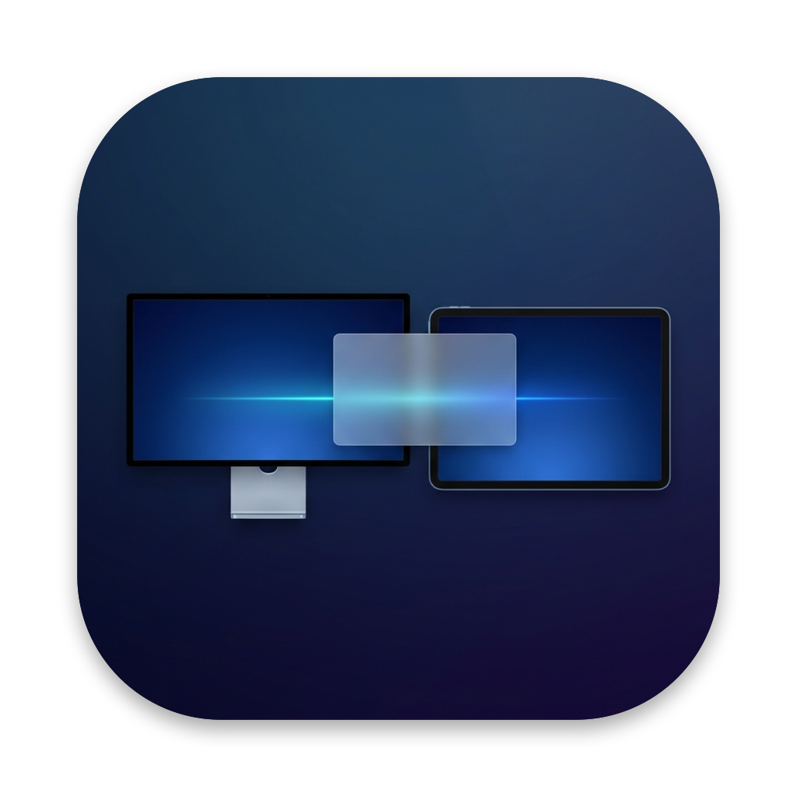

<p align="center">
  
</p>

# PadDisplay

Turn your iPad into an extended second monitor for macOS over **Wi-Fi** or **USB cable** — **with no iOS app required**.

PadDisplay runs natively in your Mac's menu bar, creates a real macOS virtual display (`CGVirtualDisplay`), captures it with `ScreenCaptureKit`, and streams it directly to **iPad Safari** (installable as a fullscreen Home Screen PWA).

## Features

- **Zero iOS App Needed:** Just scan the QR code in the Mac menu bar with your iPad camera to open the display in Safari (or *Share → Add to Home Screen* for borderless fullscreen).
- **Hybrid Streaming Modes:**
  - **Instant HTTP (`:8080`):** Zero-setup hardware JPEG stream over WebSocket — works immediately out of the box.
  - **60fps H.264 HTTPS (`:8443`):** Hardware `VideoToolbox` H.264 streamed into Safari's `WebCodecs` `VideoDecoder` (~25–45ms latency), unlocked via a 1-tap local Root CA `.mobileconfig` profile served by PadDisplay.
- **Wi-Fi & Wired USB Cable:** Automatically detects both Wi-Fi and macOS USB networking (*System Settings → General → Sharing → Internet Sharing → iPad USB*).
- **Touch & Apple Pencil Input:** Single tap (left click), drag, long-press or 2-finger tap (right click), and 2-finger pan (smooth scroll), mapped directly onto the virtual display via `CGEvent`.
- **iPad Presets & HiDPI:** Built-in presets for iPad Pro 13", iPad Pro/Air 11", iPad 10.9", iPad mini 8.3", and 1080p in Landscape or Portrait with optional HiDPI (Retina 2×).

## Requirements

- macOS 14.0+ (Apple Silicon)
- iPad with Safari (iPadOS 16.4+ for 60fps H.264 WebCodecs mode; any modern iPadOS for Instant HTTP mode)

## Quick Start (Prebuilt Release)

1. Download `PadDisplay-v1.0.0-macos-arm64.zip` from [Releases](../../releases), unzip it, and move `PadDisplay.app` to `/Applications` (or run it directly).
   > Since `PadDisplay.app` is ad-hoc signed, on first launch right-click → **Open** (or run `xattr -dr com.apple.quarantine PadDisplay.app`).
2. Click the display icon in the menu bar and press **Start**.
3. Grant **Screen Recording** permission (and **Accessibility** for Touch/Apple Pencil control).
4. Scan the QR code with your iPad!

### Connecting Over USB Cable (No iOS App)

1. Plug your iPad into your Mac with a USB-C / Lightning cable.
2. On your Mac, enable **System Settings → General → Sharing → Internet Sharing** and share to **iPad USB**.
3. Switch to the **USB Cable** tab in PadDisplay and open the USB URL on your iPad (works even with iPad Wi-Fi off).

## Building From Source

No Xcode IDE is required — only Swift Command Line Tools (`swift` 6.0+):

```bash
# Run automated tests
swift run PadDisplaySelfTest

# Build and sign build/PadDisplay.app
./scripts/build-app.sh
open build/PadDisplay.app
```
